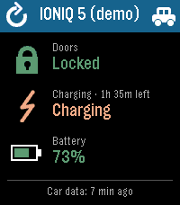
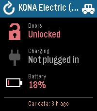
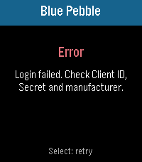
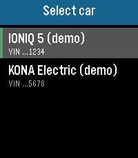

# CarGlance for Hyundai, Kia & Genesis

A Pebble watchapp that shows the status of your Hyundai, Kia or Genesis car at a glance: whether the doors are locked, whether it is charging, and the battery level.

Data comes from the [Pleos Vehicle Data API](https://document.pleos.ai/en/api-reference/vehicle-data-api/getting-started/for-private-users/overview), the official vehicle data API of Hyundai Motor Group.

All data is processed locally on your Pebble and phone. Your API credentials are stored only on your phone and are sent only to Hyundai Motor Group's API (`api.pleos.ai`), never to any third party.

> [!WARNING]
> **Alpha.** CarGlance is an early, lightly tested prototype. Expect rough edges.
>
> **EU only.** The app only works for cars registered in Europe. Hyundai currently provides the Vehicle Data API only in Europe, and issues My Vehicle Data API keys only to users there. It has been tested with a Hyundai IONIQ 5. Kia and Genesis use the same API but are untested.

<p>
  
  
  
  
</p>

## Features

- **Doors:** Locked, Unlocked, Door open or Unknown, with a padlock icon.
- **Charging:** shows Charging or Fast charging with the time remaining, Plugged in, or Not plugged.
- **Battery:** the state of charge as a percentage, with a battery icon colored green (50% and up), yellow (20–49%) or red (below 20%).
- **Refreshing:**
  - The data refreshes automatically every 10 minutes while the app is open.
  - To refresh manually, press **Select** or tap the refresh icon in the top-left corner (on touchscreen watches).
  - A refresh fetches the latest data the Pleos API has. The API can't ask the car for new data: the car uploads it on its own schedule, or when you refresh in the official Hyundai, Kia or Genesis app.
  - So the footer shows how old the car's data is (for example "Car data: 25 min ago"). It turns yellow when the data is more than an hour old.
  - If a refresh fails, the last good data stays on screen and the footer shows the error.
- **Car picker:** if the account has more than one vehicle, a car icon appears in the top-right corner. Tap it to list the cars by name and the last four digits of the VIN, then tap one to show its status. Up/Down and Select also work in the list, and Back closes it. The choice is remembered.
- **Settings page** in the Pebble phone app:
  - Step-by-step instructions for getting API credentials.
  - Fields for manufacturer, Client ID and Client Secret.
- **Demo mode:** enter `demo` as the Client ID to see sample data for two cars without an account.

Supported watch: Pebble Time 2 (`emery`).

## Getting API credentials

1. Sign up at [Pleos Playground](https://developers.pleos.ai), Hyundai Motor Group's developer portal, and sign in.
2. Open **Workspace › My Vehicle Data API**. This menu is only shown to users in Europe.
3. Select your manufacturer's tab, then accept the Terms and Conditions and the Privacy Policy.
4. Click **Get API Key** and sign in with your manufacturer account (for example Hyundai Bluelink).
5. Copy the **Client ID** and **Client Secret** into the CarGlance settings in the Pebble phone app.

Only vehicles registered when the key was issued are available. For a car you added later, revoke the key and issue a new one.

## Architecture

```
┌────────────── Watch ──────────────┐  AppMessage  ┌────────── Phone (PebbleKit JS) ─────────┐  HTTPS  ┌──────────────┐
│ src/embeddedjs/main.js            │ ◄──────────► │ src/pkjs/index.js                       │ ◄─────► │ api.pleos.ai │
│ Alloy (Moddable XS) + Poco        │   summary /  │ token, vehicle lookup, data mapping     │         └──────────────┘
│ rendering, buttons, touch, timer  │   REFRESH    │ src/pkjs/config.js (Clay settings page) │
└───────────────────────────────────┘              └─────────────────────────────────────────┘
```

**Watch (Alloy).**
- The watch side is written in JavaScript and runs on the watch's Moddable XS engine.
- It draws everything with Poco, using system fonts and icons built from basic shapes.
- It never talks to the network. It shows whatever the phone sends and asks for new data with a `REFRESH` message.
- `src/c/mdbl.c` is the standard Alloy startup file.

**Phone (PebbleKit JS).** The phone side makes all API calls with `XMLHttpRequest`:
1. It requests an access token from `POST /v1/auth/personal-token`, using the Client ID, the Client Secret and a `Brand` header.
2. It lists the account's vehicles through `GET /v1/vehicles/consent` and caches the list until the settings change. The selected car is shown, or the first one if none was picked yet.
3. It requests `GET /v1/vehicles/{vin}/status` for the doors and `GET /v1/vehicles/{vin}/batteries` for charging, both at the same time.
4. It reduces the results to a few values (`LOCKED`, `PLUGGED`, `CHARGING`, `SOC`, `REMAIN_MIN`, `DATA_TIME`, …) and sends them to the watch.

The API has no refresh token, so the cached token is renewed and the request retried once when the API reports it as expired or invalid.

**Settings and secrets.**
- The settings page is built with [Clay](https://github.com/pebble-dev/clay), with automatic event handling turned off.
- Your credentials are stored only in the phone app's `localStorage`. They are never sent to the watch, and the phone only uses them to call `api.pleos.ai`.
- In the emulator, the page is served as a self-contained page, because Clay's old HTTP-only proxy page doesn't load in browsers that force HTTPS.

**Message keys.** The keys are declared in `package.json` under `pebble.messageKeys` and must match the `keys` list in `main.js`.

```
├── package.json             # app metadata, message keys, Clay dependency
├── wscript                  # standard Pebble build script
└── src
    ├── c/mdbl.c             # Alloy startup file
    ├── embeddedjs/
    │   ├── main.js          # watch UI
    │   └── manifest.json    # Moddable manifest
    └── pkjs/
        ├── index.js         # phone-side API client
        └── config.js        # settings page definition
```

## Build and run

You need the [Pebble SDK](https://developer.repebble.com) (`pebble` tool with SDK 4.33 or newer).

```bash
pebble package install @rebble/clay   # once, installs dependencies
```
```bash
pebble build
```

**In the emulator:**
1. Install the app and show its logs:
   ```bash
   pebble install --emulator emery --logs
   ```
2. In a second terminal, open the settings page:
   ```bash
   pebble emu-app-config --emulator emery
   ```

The emulator uses its own simulated phone, but it makes real API calls, so your real credentials work there.

**On a watch:**
1. In the Pebble phone app, open Devices, tap **⋯** next to your watch and enable **Dev Connection**.
2. Install the app:
   ```bash
   pebble login && pebble install --cloudpebble
   ```
3. Open the app's settings from the Pebble phone app.

## License

Copyright (C) 2026 Matthias Gellrich

CarGlance is free software: you can redistribute it and/or modify it under the terms of the [GNU General Public License](LICENSE) as published by the Free Software Foundation, either version 3 of the License, or (at your option) any later version.

CarGlance is distributed in the hope that it will be useful, but WITHOUT ANY WARRANTY; without even the implied warranty of MERCHANTABILITY or FITNESS FOR A PARTICULAR PURPOSE. See the GNU General Public License for more details.

## Disclaimer

CarGlance is an independent project. It is not affiliated with, endorsed by or sponsored by Hyundai Motor Company, Kia Corporation, Genesis Motor or Hyundai Motor Group. Hyundai, Kia, Genesis, Pleos, Bluelink, IONIQ, Pebble and all other product and company names are trademarks or registered trademarks of their respective owners. They are used here only to describe compatibility.
